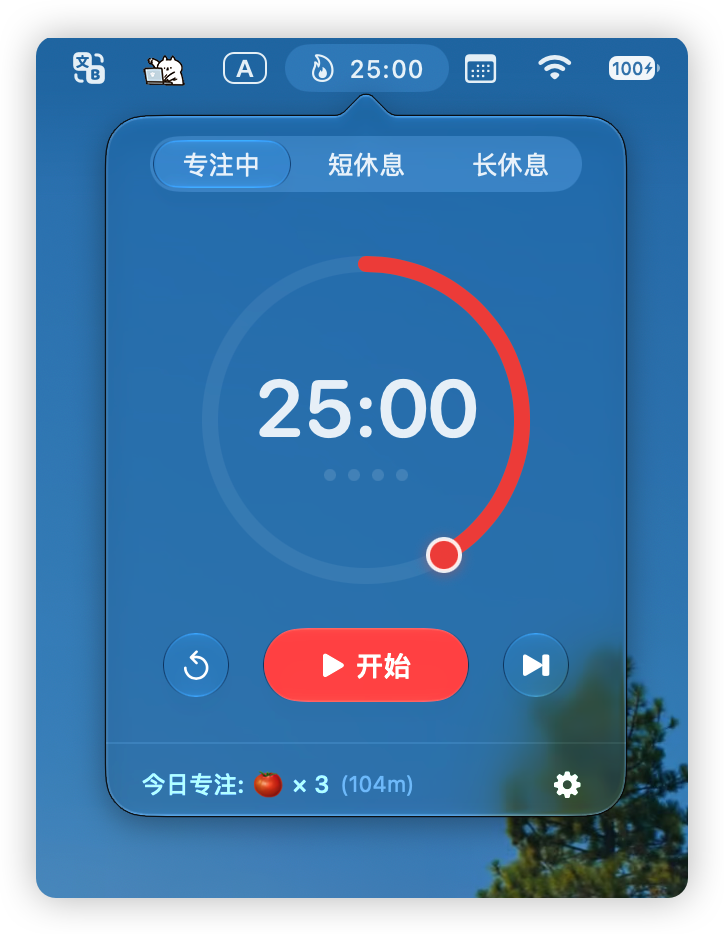

# TomatoBar



macOS 菜单栏番茄钟。启动后只在菜单栏显示图标和倒计时。

需要 macOS 15 或更高版本。macOS 27 使用 Liquid Glass 分段控件和按钮，更早的系统使用标准分段选择器和按钮。

## 功能

- 标准番茄流转：25 分钟专注、5 分钟短休息，每 4 个番茄进入 15 分钟长休息。
- 菜单栏实时倒计时。计时中为实心图标，暂停为空心图标。
- 拖动圆环调节剩余时间，进行中也可以改，松手后按新时间继续。一圈为 60 分钟，按整分钟吸附。
- 左键打开面板。右键，或按住 Option 再点击，直接开始或暂停。
- 阶段结束时发送系统通知。未开启自动开始时，通知里可以一键开始下一阶段。
- 记录当天完成的番茄数和专注分钟数。

## 构建

需要 Xcode 27 自带的 Swift 工具链。

```bash
./build_app.sh
open dist/TomatoBar.app
```
